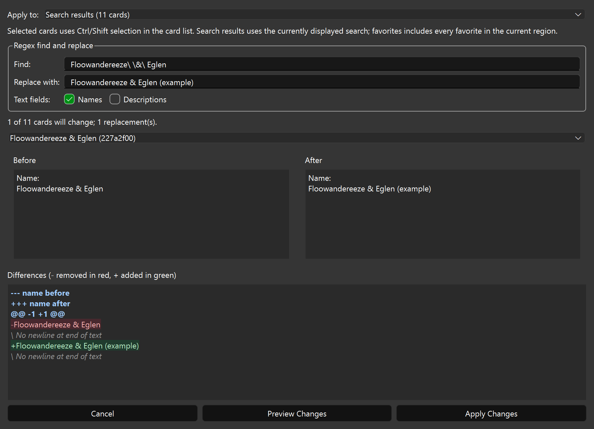

# Regex mass editing

Open **Mass Edit** on the Cards page. Choose **All cards**, **Selected cards**,
**Search results**, or **Favorites**. All scopes use the current TCG/OCG region.
Use Ctrl-click or Shift-click in the card list to select multiple cards before
opening the dialog. Search results uses the last executed search currently
displayed in the list; it is empty when no search is displayed or the favorites
filter is active. Favorites includes every favorite, regardless of the search.

Enter a Python regular expression and replacement text (capture references such
as `\1` are supported), then choose names, descriptions, or both. Empty
replacement text deletes matches. Existing text edits are the starting text.

Click **Preview Changes** to see the number of affected cards and replacements.
Choose an affected card to inspect its full before/after text and line differences.
The **Differences** block highlights removed lines in red and added lines in green,
with subtle matching backgrounds. Diff headers are blue and bold; newline notes
are muted and italic. Colors adapt to light and dark themes. The `-` and `+`
prefixes remain visible so changes can also be identified without color.

Identical replacements do not count as changes. Previewing does not write game
files. **Apply Changes** is enabled only after a preview with actual changes;
changing any input or scope requires another preview. Applying writes only the
chosen cards. Wait for the operation to finish before closing the app.

