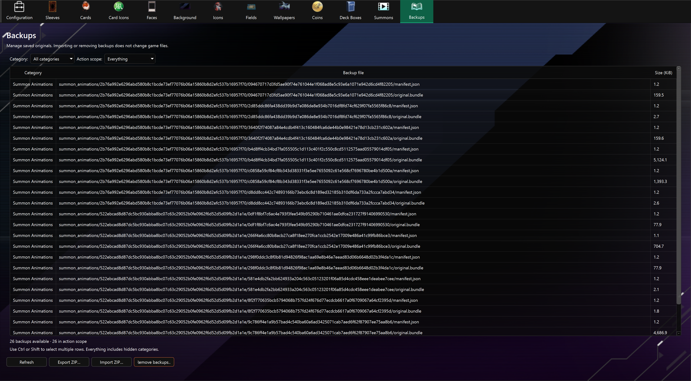

# Backups

The **Backups** tab uses the backup icon in the navigation toolbar.

The **Backups** tab lists files saved in the tool's local `backups/` directory. It works even before a game path is configured. Open the tab or click **Refresh** to update the inventory after editing assets.

## Choose files

The table shows each backup's category, relative file path, and size. Use **Category** to filter the table, then choose an **Action scope**:

- **Everything** includes all backups, including categories hidden by the filter.
- **Current category** includes every backup in the chosen category. Choose a specific category first.
- **Selected backups** includes the highlighted rows. Use Ctrl-click or Shift-click to choose multiple files.

Player icons and card icons share the **Player & Card Icons** category. Cards also includes overframe framing backups, and deck box resolutions are listed separately. Other backup folders appear under their folder names.

## Export

Choose a scope, click **Export ZIP…**, and select a destination. The archive preserves paths relative to `backups/`, so it can be imported into another copy of the tool. Exporting leaves the local backups in place.

## Import

1. Click **Import ZIP…** and choose an exported archive.
2. In the archive preview, choose everything, a category, or individual rows.
3. Click **Import**. If files already exist, choose **Yes** to replace them, **No** to keep them and import only new files, or **Cancel** to stop.

Archives must store files directly under their category folders, for example `cards/12345678.png`, rather than inside an extra `backups/` folder. Root-level background files and nested overframe files retain their original paths. Unsafe paths, duplicate paths, symbolic links, and archives over 4 GiB or 100,000 files are rejected. Selected files are read and checked before local files are changed; an operating-system write failure can still leave a partially completed import. Refresh the inventory and retry after resolving the failure.

Import stores backup files; use the relevant editor’s **Restore** control to apply them to the game. Archives do not include saved card text edits, settings, or the game itself. Overframe framing backups work only with the player profile they were created for; importing them does not transfer them to another profile.

## Remove

Choose a scope and click **Remove backups…**, then confirm the displayed file count. Removal is permanent, so export any files you may need first. Removing a backup does not restore or otherwise change the game asset. Backup indicators in the editors are updated after imports and removals.

Automatic backup creation is still controlled in [Configuration](config.md). Backups are not created retroactively.

## Summon animation originals

**Summon Animations** contains the original animation files and the information needed to restore them. Export or import the complete category, keeping each `manifest.json` with its adjacent `original.bundle`. Restore animations from [Summons](summon-animation.md); importing a ZIP does not change game files.