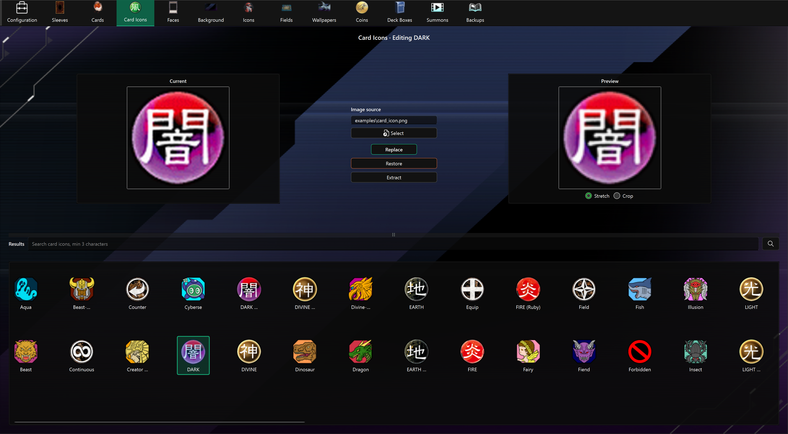

# Card Icon Editor

The Card Icon Editor changes small card-related graphics stored inside Master Duel's shared card sprite atlas.

## Find an asset

Results show asset names. Hover over a shortened label to see its full name. The selected asset's name also appears above the editor. Assets without a translated name retain their code.

Type at least three characters in the search bar, then press **Enter**, click **Search**, or choose a completion suggestion. Search matches part of the name without case sensitivity. Clear the search bar to show all results again.

After updating the app, use **Check** in [Configuration](config.md) to download the new names, then restart the app. Favorites and backups are preserved.

## Replace an icon

1. Select an icon from **Results**.
2. Choose a PNG or JPEG with **Select**, or drag an image onto the page.
3. Compare **Current** and **Preview**.
4. Choose **Replace**.

The app resizes the source to the selected atlas region and replaces the complete region, including transparent pixels. PNG is strongly recommended when the icon needs transparency.

## Extract and restore

- **Extract** crops the selected region from the atlas and saves it under `images\icons` using the icon's name.
- **Restore** patches the backed-up region into the atlas.

Automatic backup captures the selected region immediately before its first replacement, provided backups are enabled.

## Important limitation

All card icons share `masterduel_Data\data.unity3d`. A game update or another mod that replaces this file may remove every card-icon change, plus other modifications stored in the same file. Refresh the app data after game updates before editing the atlas again.
