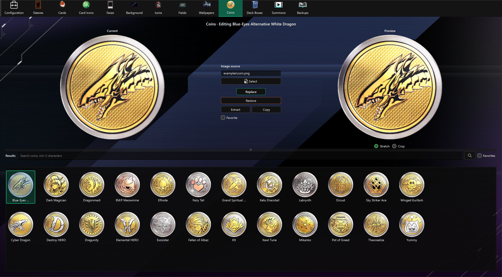

# Coin Editor

The Coin Editor replaces duel coin textures and keeps the game's small, medium, and large versions together.

## Find an asset

Results show asset names. Hover over a shortened label to see its full name. The selected asset's name also appears above the editor. Assets without a translated name retain their code.

Type at least three characters in the search bar, then press **Enter**, click **Search**, or choose a completion suggestion. Search matches part of the name without case sensitivity. Clear the search bar to show all results again.

**Favorites** shows all favorites independently of the search; turning it off restores the last executed search.

After updating the app, use **Check** in [Configuration](config.md) to download the new names, then restart the app. Favorites and backups are preserved.

## Replace a coin

1. Select a coin from **Results**.
2. Choose a square PNG or JPEG with **Select**, or drag it onto the page.
3. Check **Preview** and choose **Replace**.

The app creates the required small, medium, and large square textures from the same source image. Use a square source to prevent distortion; PNG is recommended for transparency.

## Other actions

- **Favorite** marks the selected coin; **Favorites** filters the result grid.
- **Extract** saves all three size textures under `images\coins`.
- **Copy** saves all three Unity bundles under `bundles\coins`.
- **Restore** uses the backup of the largest version to rebuild all three sizes.

Enable backups before the first replacement. Only the largest original texture is stored as the automatic backup.
