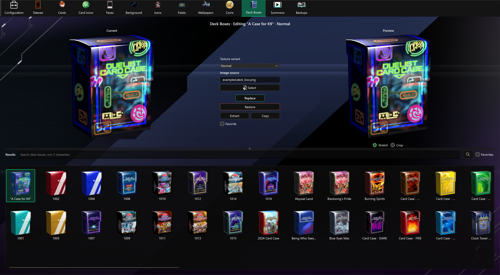

# Deck Box Editor

The Deck Box Editor replaces deck box artwork and handles its different resolutions automatically.

## Find an asset

Results show asset names. Hover over a shortened label to see its full name. The selected asset's name also appears above the editor. Assets without a translated name retain their code.

Type at least three characters in the search bar, then press **Enter**, click **Search**, or choose a completion suggestion. Search matches part of the name without case sensitivity. Clear the search bar to show all results again.

**Favorites** shows all favorites independently of the search; turning it off restores the last executed search.

After updating the app, use **Check** in [Configuration](config.md) to download the new names, then restart the app. Favorites and backups are preserved.

## Replace a deck box

1. Open **Deck Boxes** and select a box from **Results**.
2. Choose its **Texture variant**: **Normal**, **Left Facing**, or **Open**.
3. Use **Select** or drop a PNG or JPEG onto the page.
4. Choose **Stretch** or **Crop** and check **Preview**.
5. Choose **Replace**, then check the result in Master Duel.

Current and Preview use the large version of the selected orientation. Replace applies the same artwork to all matching resolutions automatically, preserving each texture's dimensions. Normal includes small, medium, and large; Left Facing and Open each include medium and large. Other orientations remain unchanged. Replacement artwork can fill the whole image without being clipped to the original box silhouette. PNG transparency still controls the visible shape. Reapply **Replace** to fix a deck box edited with an older version of the app.

## Other actions

- **Favorite** marks the deck box; **Favorites** filters Results.
- **Extract** saves the large texture of the selected orientation under `images\deck_boxes`.
- **Copy** saves all Unity bundles for the selected orientation under `bundles\deck_boxes`.
- **Restore** restores all resolutions of the selected orientation from `backups\deck_boxes`.

Enable backups in [Configuration](config.md) before replacing textures. Each resolution gets its own backup before its first replacement; existing backups are preserved. Restore requires backups for all resolutions of the selected orientation, and restores each original texture separately. Older backups made for only one resolution can still be restored individually through Configuration's bulk restore. Configuration's bulk restore and clear actions also include deck box backups.

Restore puts back the original artwork and transparency, but keeps the full rectangular image area used by replacements. If game files are missing, complete the in-game download before editing. Use **Check** in Configuration to refresh outdated asset data.
