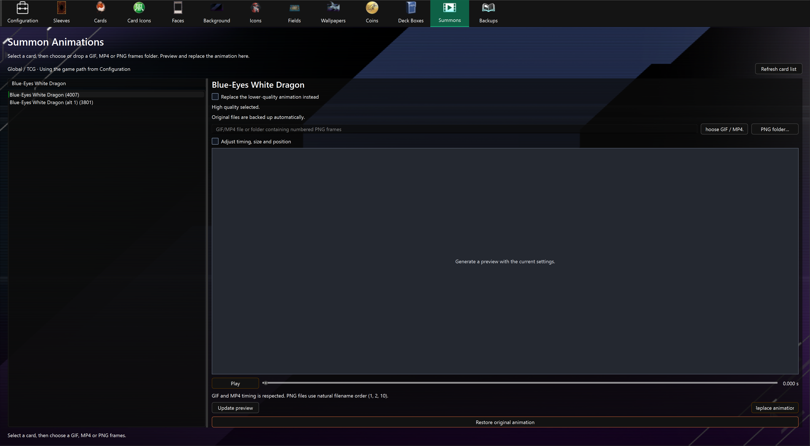

# Summon Animation Editor

The **Summons** tab uses the animation icon in the navigation toolbar.

The **Summons** tab replaces a monster's summon animation from a GIF, MP4 video or individual PNG frames. Select the card and your input; the app chooses the matching animation assets automatically.

## Replace an animation

1. In [Configuration](config.md), set your **Game Path** and choose **TCG** for the Global game or **OCG** for the OCG game. Summons uses these settings automatically, including any additional installed game assets.
2. Open **Summons** and search for the card by name or ID.
3. Leave **Replace the lower-quality animation instead** unchecked to replace high quality. Check it to replace lower quality instead. The other version keeps its artwork unless the card shares the same skeleton between quality modes; the preview and confirmation warn when both modes will change.
4. Choose **Choose GIF / MP4** or **PNG folder**, or drop one local GIF/MP4 file or a folder containing PNG frames anywhere in the Summons tab. The preview prepares automatically in the right-hand panel. MP4 frame timing is retained; audio is ignored.
5. Play or scrub the inline preview. Open **Adjust timing, size and position** only if you want to change the defaults, then press **Update preview**.
6. Close Master Duel and press **Replace animation**. Original files are backed up automatically.

Large inputs show a **Large animation import** memory estimate before frame conversion. Choose **Yes** to continue or **No** to cancel. This warning can be overridden; incompatible formats, playback structures and atlas capacity still prevent replacement. See [memory estimates and limits](summon-frames.md#limits).

Drag the divider to resize the card list. Input, playback, settings and replacement controls stay in the tab; expanded controls scroll on smaller windows.

The source stays selected when you change cards or quality, and the preview rebuilds for the new target. A drop before card selection is retained until you select a card. Empty folders, single PNG files, remote URLs and multiple dropped items are ignored. Decoding errors appear in the preview panel. Target controls and additional drops are disabled while the app prepares or replaces an animation.

See the [GIF, MP4 and PNG guide](summon-frames.md) for input formats, timing and limits.

Summons uses your current Configuration settings when reopened. Choose **Refresh card list** after updating app data. It only uses assets from your selected game version and installation.

If the selected quality is unavailable, choose the other quality using the checkbox. Missing game downloads or outdated app data can also prevent replacement. Complete the in-game download and choose **Check** in Configuration before trying again. See [compatibility details](summon-frames.md#custom-materials-and-effect-tracks) for cards with additional effects.

## Back up and restore

Original animation files are always backed up under `backups/summon_animations`, even when image backups are disabled. Later replacements keep the first backup.

Select the card and press **Restore original animation**. The app chooses all verified backups for that card automatically, including both quality versions and shared playback data. Confirmation identifies other cards when they share affected files. Restoration replaces complete bundles, so it also reverts edits sharing those files.

Use the [Backups tab](backups.md) to export/import the **Summon Animations** category. Keep each **manifest.json** and its adjacent **original.bundle** together. ZIP import changes backups only. Automatic remapping to a different local installation remains unsupported.
