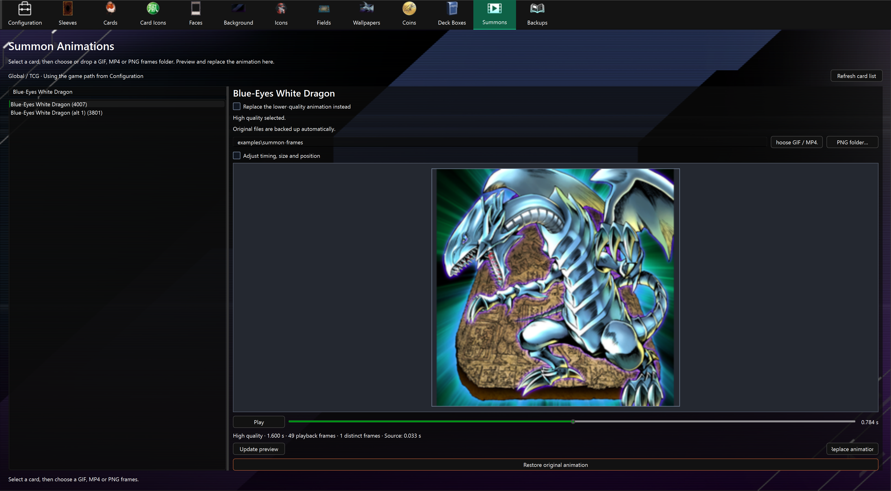
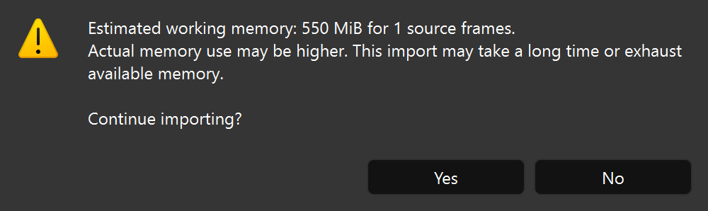

# GIF, MP4 and PNG summon animations

Choose a card in **Summons**, then press **Choose GIF / MP4** or **PNG folder**, or drop a GIF/MP4 file or PNG frames folder into the tab. The editor finds the correct animation automatically using the game version and path from [Configuration](config.md).

High quality is selected by default. Check **Replace the lower-quality animation instead** before choosing your input to target lower quality. The other quality keeps its artwork, including any earlier replacement, unless both modes use the same skeleton. Shared-quality cards show a warning in the preview and replacement confirmation.

## Preview and replace

The preview prepares automatically in the same tab after choosing or dropping the input. It stays selected when you switch cards or quality, and the preview rebuilds for the new target. Play/pause or scrub it, then close Master Duel and press **Replace animation**.

PNG files sort naturally: `frame1.png`, `frame2.png`, `frame10.png`. Non-PNG files in the folder are ignored. GIF frames use their individual delays, disposal and transparency. GIF loop counts do not extend the summon clip.

MP4 imports use the first video stream and its frame timestamps, including variable frame rates. Audio is ignored. Ordinary MP4 video has an opaque background; use GIF or PNG frames for transparent artwork. The **PNG source FPS** setting affects PNG sequences only. Video uses the same fit/crop, output FPS, timing, preview and replacement controls as GIFs.

MP4 support is included in the packaged app; no additional video tools are required.

Defaults fit the source to the original summon duration at 30 FPS, with a 256-pixel long edge and transparent padding.

Open **Adjust timing, size and position** for optional controls:

| Control | Behavior |
| --- | --- |
| PNG source FPS | Playback speed of an image sequence. |
| Output FPS | Number of sampled output frames per second. |
| Frame resolution | Long edge of each frame; lower it if capacity is exceeded. |
| Fit / Crop | Add transparent padding or crop to fill the original framing bounds. |
| Size and offsets | Scale and position the artwork; positive vertical offsets move upward. |
| Fit timing | Stretch/compress the source to the original summon duration. |
| Keep speed | Trim long input; hold the last frame of short input. |

Changing settings clears the preview and disables replacement until you choose **Update preview**. The preview displays generated frames and framing, rather than the full game camera, effects, audio or shader behavior.

## Limits

- GIF, MP4 video and individual PNG frames are supported. Animated PNG and other video file extensions are unsupported. Corrupt files, unsupported codecs and MP4s without usable video or timing show an import error.
- Large inputs, or videos whose memory use cannot be estimated, show **Large animation import** before conversion. Choose **Yes** to continue or **No** to cancel. The estimate is approximate; actual memory use can be higher.
- Cancelling clears the preview and disables replacement. Shorten or downscale the source, or lower **Frame resolution**, to reduce memory use. Lowering **Output FPS** alone may not reduce the memory needed to read the source.
- The memory warning can appear again when you change the source, settings, card or quality, or update the preview.
- Output supports 1–60 FPS, a 32–1024-pixel long edge and a clip no longer than ten seconds.
- The selected card’s animation files have limited space for frames. If the animation does not fit, lower **Frame resolution**, lower **Output FPS**, or shorten the clip.
- Some cards have unsupported animation structures or effects. The app reports a compatibility error and prevents replacement. Refresh app data and complete the game’s asset download if the error indicates missing or outdated files.

Select the card and choose **Restore original animation** to restore both quality versions to their backed-up state. See [backup and restore details](summon-animation.md#back-up-and-restore).

## Shared playback compatibility

Some cards, including Fiendsmith Engraver in Global assets, share an animation between high and low quality. Replacing either quality can affect both. Review the shared-quality warning in the preview and replacement confirmation before proceeding.

For cards with separate quality versions, the unselected version keeps its existing artwork, including earlier replacements. Restoring the original animation restores both versions.

## Custom materials and effect tracks

Cards such as Fallen of Albaz, Aluber the Jester of Despia and Archfiend Emperor have additional visual effects. Supported effects are preserved, but the preview does not show all game effects, lighting or camera behavior. Some effects may also affect how your replacement looks.

Always check placement, transparency and playback in-game at the quality you replaced before sharing a mod. Compatibility checks cannot guarantee the final appearance. If a card’s effects or playback are unsupported, the app prevents replacement; try another card or restore its original animation.
